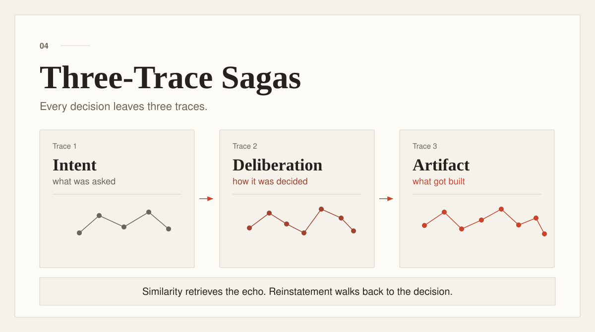

# Self-Reflect

<div align="center">


[](https://www.npmjs.com/package/claude-self-reflect) [](https://www.npmjs.com/package/claude-self-reflect) [](https://opensource.org/licenses/MIT) [](https://github.com/ramakay/claude-self-reflect/releases/latest) [](https://github.com/anthropics/claude-code) [](https://modelcontextprotocol.io/) [](https://github.com/ramakay/claude-self-reflect/tree/main/csr-engine) [](https://github.com/ramakay/claude-self-reflect) [](https://github.com/ramakay/claude-self-reflect/stargazers)

**Claude reflects on its own work, and shows the receipts.**

Self-Reflect is Claude reflecting on its own work: a recap when a session starts, receipts for what got done, dreams that check old conclusions against your git history, and a compact that keeps its evidence. A pane beside the session shows how Claude is doing.

A memory layer sits underneath as plumbing. It is one Rust binary (about 138 MB) with embedded SQLite, no database server, no containers, no Python and no API keys required.

[Install](#install) | [What it does](#what-it-does) | [Paper](#the-paper) | [Help wanted](#help-wanted-what-needs-work) | [Docs](https://ramakay.github.io/claude-self-reflect/) | [Release notes](CHANGELOG.md) | [Archive](docs/README-archive.md)

> **v10.1.0: Claude reflects on its own work.** Full release notes are in the [CHANGELOG](CHANGELOG.md). Older README detail is in the [archive](docs/README-archive.md).

</div>

## Contents

- [What it does](#what-it-does): Claude reflecting on its own work
- [The Paper](#the-paper): the research behind the retrieval design (two papers)
- [Help wanted](#help-wanted-what-needs-work): open questions, and a prompt to hand your agent
- [Install](#install): one command, consent-first activation, platforms
- [Uninstall](#uninstall): what it removes, and what it keeps
- [Archive](docs/README-archive.md): architecture, pipeline, smaller features, engineering numbers, reference

---

## What it does

Without a record, Claude starts every session not knowing what it finished last time, what it left open, or what you corrected. Self-Reflect keeps that record and makes Claude show the evidence.

- **Recap:** a session opens with one paragraph: intent, what got done, what was settled, what is open, the next step.
- **Receipts:** every clause cites a commit, a task, a verdict or a correction. A clause with no evidence drops out.
- **Dreams:** CSR checks old conclusions against your git history and marks a stale one with the commit that changed it. No LLM in that check.
- **Compaction:** after a compact, Claude gets pointers to the turns the summary replaced, and `csr_transcript` reads them back.
- **How is Claude doing:** the companion pane shows what Claude was told, what it missed and what you corrected.
- **Plumbing:** search over your past sessions (SQLite and a local vector index) sits underneath. Claude can also call it directly through the MCP tools.

No special syntax. Install once, and the recap and receipts show up on their own.

> **[Explore the full documentation →](https://ramakay.github.io/claude-self-reflect/docs/)**

---

## The Paper

<a href="docs/plans/annaswamy-2026-similarity-drowns-intent.pdf">
<picture>
  <source media="(prefers-color-scheme: dark)" srcset="docs-site/public/images/card-04-paper-dark.svg" />
  
</picture>
</a>

CSR's retrieval design is documented in two papers, measured on the system's own development history:

> **Similarity Drowns Intent: Three-Trace Sagas and Reinstatement Recall for Provenance in Agentic Software Construction**
> 2026, version 2 — [PDF](docs/plans/annaswamy-2026-similarity-drowns-intent.pdf)
>
> **Evaluating a System That Records Its Own Sessions** (short version, 14 pages)
> 2026 — [PDF](docs/plans/annaswamy-2026-evaluating-self-recording-agents.pdf)

Ask "why did we drop Qdrant?" and one-shot similarity search returns earlier recordings of the question itself; the decision ranks below its own echoes. The full paper measures that failure and the seed-conditioned walk built to counter it (+53% ground-truth session coverage over one-shot cosine kNN in a pre-registered spike). It also reports a failure that fell out of evaluation: a system that records its own sessions records its evaluation too. In a controlled test, five scripted re-ask cycles took about half of naive retrieval's top 10, and echo defenses removed 72% of that.

It keeps its losses. In a later pre-registered benchmark, a simpler hybrid of dense and full-text search beat the walk on exact receipt lookup (recall@5 0.813 against 0.581 on 396 queries), and the two did not separate on sealed multi-hop questions. A ratification-weighting hypothesis died at ρ≈0. The short paper turns these results into seven evaluation controls; every number in it has a public receipt in [`csr-engine/eval-kit/`](csr-engine/eval-kit/) and `docs/plans/`.

<br clear="both" />

---

## What we're working on

Seven engineering items, each with a measured number, a target and the next step, are in the [archive](docs/README-archive.md#what-were-working-on). The open research questions are below.

### Help wanted: what needs work

The papers say plainly what is not shown yet. These are the open questions where an outside run would help most. Open an [issue](https://github.com/ramakay/claude-self-reflect/issues) with a result, start a [discussion](https://github.com/ramakay/claude-self-reflect/discussions) with a suggestion, or send a pull request from a fork.

| Open question | Where it stands | What would settle it |
|---|---|---|
| Does it hold on someone else's history? | Every result comes from one operator's corpus. | Rerun the T3 and T4 kits in [`csr-engine/eval-kit/`](csr-engine/eval-kit/) on another corpus and publish the queries, labels and scores. |
| A public contamination fixture | E3 used one dose on a private corpus; only its spec is public (`eval-kit/e3/spec.md`). | A rerunnable fixture with several doses, paraphrased re-asks and matched controls. |
| Recovery after compaction, in real use | Transcripts Claude Code deleted stay readable, but agents almost never call `csr_transcript` after a compaction. | A controlled resume study: the same task resumed with and without the recovery tool. |
| Paraphrased questions | Verbatim recall is near ceiling; paraphrase recall is weak. | A fresh set of natural paraphrase queries and a ranking change that clears a stated bar. |
| Staleness benchmark | T4 has no held-out tag with a change that was later restored. | Add that case to the T4 kit and rerun. |
| Lost and found, Same page | Both are built; neither has a labelled accuracy set. | A small hand-labelled set and a score against it. |

**A prompt to hand your coding agent.** Copy it, fill in the item, and run it in a throwaway environment.

```text
You are contributing an outside measurement to Self-Reflect
(https://github.com/ramakay/claude-self-reflect). Work only in a throwaway
environment: a Linux container, a VM, or a CI runner. Do not install it into
my everyday account; on macOS, setup also installs a launch agent.

1. Clone the repo. Read docs/plans/annaswamy-2026-evaluating-self-recording-agents.pdf,
   csr-engine/eval-kit/README.md and the "Help wanted" table in README.md.
   The item I want to work on: <ITEM FROM THE TABLE>.
2. Corpus. Either my own Claude Code history (copy ~/.claude/projects into the
   sandbox; never paste transcript text into any issue or PR), or public MIT-licensed
   Claude Code transcripts from Hugging Face:
     hf download armand0e/claude-fable-5-claude-code --repo-type dataset --local-dir "$SCRATCH/hf/fable"
     hf download crispwisp/wisp-claude-code-sessions --repo-type dataset --local-dir "$SCRATCH/hf/wisp"
   Put each session's .jsonl under "$SCRATCH/home/.claude/projects/<project-folder>/".
   Both public sets were used to fine-tune the shipped reranker (see
   csr-engine/assets/models/ettin-tuned-run2/NOTICE). Use them to try the harness
   and for measurements that do not score retrieval. Do not use them, or any set
   listed in that NOTICE, for a scored retrieval comparison: the reranker has seen them.
3. Use the scratch home for every command from here on, including step 5. The
   installer puts the binary in $HOME/.local/bin, so add it to PATH too:
     export HOME="$SCRATCH/home" PATH="$SCRATCH/home/.local/bin:$PATH"
     curl -fsSL https://raw.githubusercontent.com/ramakay/claude-self-reflect/main/scripts/install.sh | sh
     csr-engine setup --no-companion
     csr-engine status        # check the session and chunk counts match your corpus
4. Before you measure, write down the question, the metric, the control and the bar
   that would count as a pass. Commit that note first.
5. Run the measurement in the same shell (the eval-kit scripts, `csr-engine eval --full`,
   or `csr-engine bench`). Keep every command and its raw output.
6. Report: the corpus (name and counts), the pre-registered bar, the result, what
   failed, and the exact commands. A null or a loss is a useful result; say so plainly.
   Never invent a number. Open it as an issue, or as a pull request from a fork if you
   changed code or the kit.
```

Public datasets above: [armand0e/claude-fable-5-claude-code](https://huggingface.co/datasets/armand0e/claude-fable-5-claude-code) and [crispwisp/wisp-claude-code-sessions](https://huggingface.co/datasets/crispwisp/wisp-claude-code-sessions), both MIT. Both are small (under 1,000 sessions each), and the wisp set includes headless runs, so report human and headless counts separately. **Both were part of the reranker's fine-tuning data**, so a retrieval score measured on them would look better than it is. Scored retrieval comparisons need your own history or a set that is not in [the reranker's NOTICE](csr-engine/assets/models/ettin-tuned-run2/NOTICE).

---

## Install

```bash
curl -fsSL https://raw.githubusercontent.com/ramakay/claude-self-reflect/main/scripts/install.sh | sh
```

Downloads the binary (SHA256-verified), then asks before activating. Setup registers the MCP server, installs 8 hooks on 7 events, imports your conversations, installs the companion plugin and, on macOS, installs and starts the background daemon (a launchd agent that runs dreams and enrichment; `CSR_NO_DAEMON=1` skips it). It only runs with your consent. Restart Claude Code after.

Non-interactive installs never activate on their own: set `CSR_AUTO_SETUP=1` to opt in, or run `csr-engine setup` yourself.

To pin a release, pass `--version` (`curl -fsSL .../install.sh | sh -s -- --version v10.1.0`) or set `CSR_VERSION=10.1.0`. To install from files you already have, set `CSR_TARBALL=/path/to/csr-engine-<target>.tar.gz` with `checksums.txt` beside it (or `CSR_CHECKSUMS=/path`), or `CSR_RELEASE_BASE_URL` to a directory or URL that holds both files. A local tarball, directory or file:// source makes no network call, and the checksum is always verified: without a checksums file the install stops.

Upgrading from 9.5.8 or a 10.x install? Install the new binary, then run setup again through the installer: `claude-self-reflect setup` with npm, or answer yes at "Run setup now?" in the curl installer. That applies new hooks and launch agent settings. Restart Claude Code after. See [Upgrading](docs/README-archive.md#upgrading-within-10x).

**What calls `claude -p`.** Some features run the Claude Code CLI in print mode (`claude -p`) as a child process. It runs under your own Claude account, so it uses your plan's usage (or your API key's billing, if that is how Claude Code is set up); CSR sends nothing to any other service for this. The callers are the `session-briefing` SessionStart hook (on startup and resume; once a briefing is stored for a project, there is no new call for it for 30 minutes), session narratives and stories, the daemon's ratification pass, and dreams. `CSR_NO_AI_NARRATIVES=1` turns all of them off, the briefing included. `CSR_NO_DREAMING=1` stops dreams only and `CSR_NO_RATIFICATION=1` stops ratification only.

How many calls to expect, which model each caller uses, and the variables that change them: see [what calls `claude -p`](docs/README-archive.md#what-calls-claude--p-in-numbers) in the archive.

| Platform | Support |
|----------|---------|
| macOS (Apple Silicon) | Prebuilt binary |
| Linux x86_64 / WSL | Prebuilt binary |
| Linux ARM64 | Prebuilt binary |
| macOS (Intel) | Not supported (no prebuilt binary; the ONNX runtime has no x86_64-apple-darwin build) |

<details>
<summary>Alternative: npm</summary>

```bash
npm install -g claude-self-reflect
claude-self-reflect setup   # activation is a separate, explicit step
```

By default `npm install` only downloads the checksummed binary — it does not touch `~/.claude` or index conversations. Activation happens when you run `claude-self-reflect setup`, or set `CSR_AUTO_SETUP=1` during install to opt in. That command runs the binary npm downloaded, so it works before `~/.local/bin` is on your PATH.

On macOS, an npm upgrade that replaces the binary also restarts an already loaded daemon (`launchctl kickstart -k`), even without `CSR_AUTO_SETUP`. It does not touch `~/.claude`.

</details>

### The companion pane (optional)

A Claude Code plugin, `csr-companion`. It shows what Self-Reflect handed Claude, the agents and Codex runs in flight, the dreamer's "what if...?", and a compaction coach. It needs Claude Code 2.1.296 or later.

#### Two ways to see the companion

| Where you run `claude` | What you get | How it opens |
|---|---|---|
| Inside [herdr](https://herdr.dev) (`brew install herdr`) | A pane to the right of Claude with the full cards. Pictures in Ghostty, kitty, WezTerm or Warp; text cards in Terminal.app. | By itself at session start in a project folder; `/csr` opens it again |
| A plain terminal, no herdr | A panel inside Claude Code with a smaller card set | By itself in a project folder in a window 144+ columns wide; narrower, type `/csr` |

Setup installs one plugin for both and does not choose between them: the plugin checks for herdr at each session start and each `/csr`. To switch, start `claude` inside or outside herdr; no reinstall. `claude plugin disable csr-companion@claude-self-reflect` turns the whole companion off. Setup, checks and troubleshooting: [Choose your view](https://ramakay.github.io/claude-self-reflect/#/docs/companion-views).

How the companion runs, the cards it draws and how to build from source are in the [archive](docs/README-archive.md#install-details).

### Uninstall

`csr-engine uninstall` removes what `setup` installed and nothing else:

```bash
csr-engine uninstall --dry-run            # print the plan, change nothing (also the default without --yes)
csr-engine uninstall --yes                # do it; your data folder ~/.claude-self-reflect is kept
csr-engine uninstall --yes --purge        # also delete the data folder, except the transcript mirror
csr-engine uninstall --yes --purge-mirror # delete the data folder and the mirror too (implies --purge)
```

What each step removes and keeps, and how to uninstall by hand, are in the [archive](docs/README-archive.md#uninstall).

---

[Documentation](https://ramakay.github.io/claude-self-reflect/) | [Changelog](CHANGELOG.md) | [README archive](docs/README-archive.md) | [npm](https://www.npmjs.com/package/claude-self-reflect) | [Issues](https://github.com/ramakay/claude-self-reflect/issues) | [MIT License](LICENSE)
