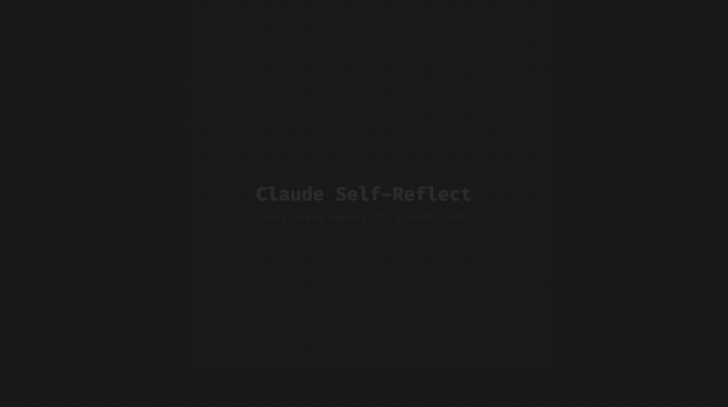
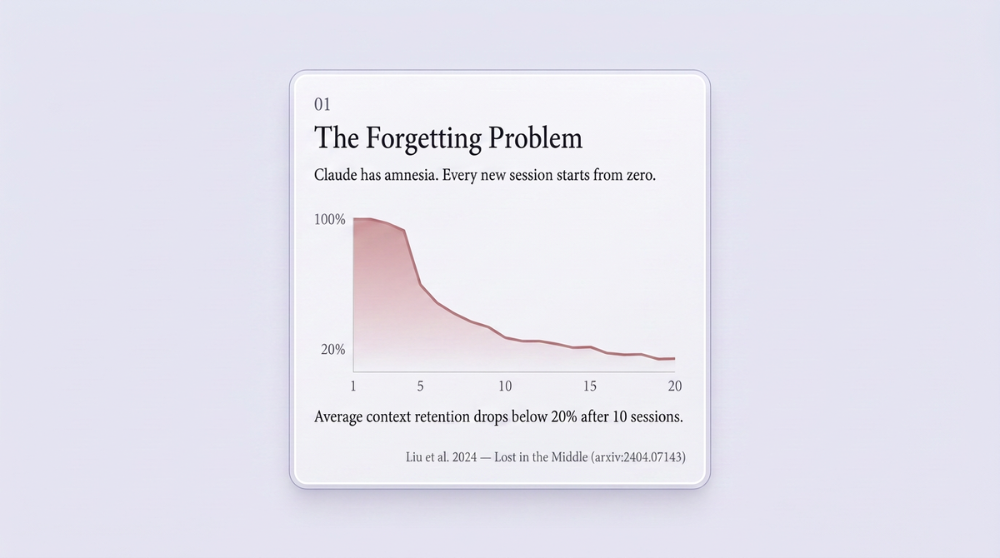
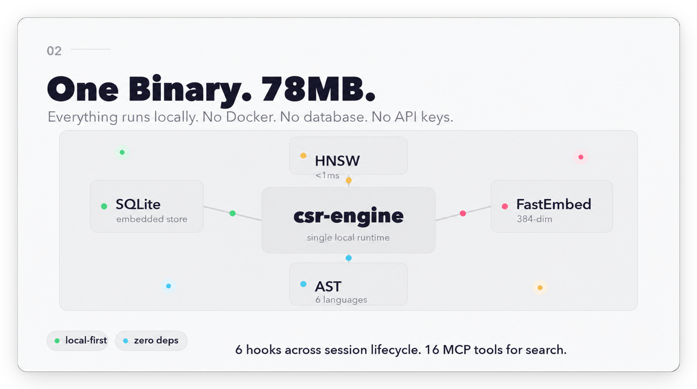
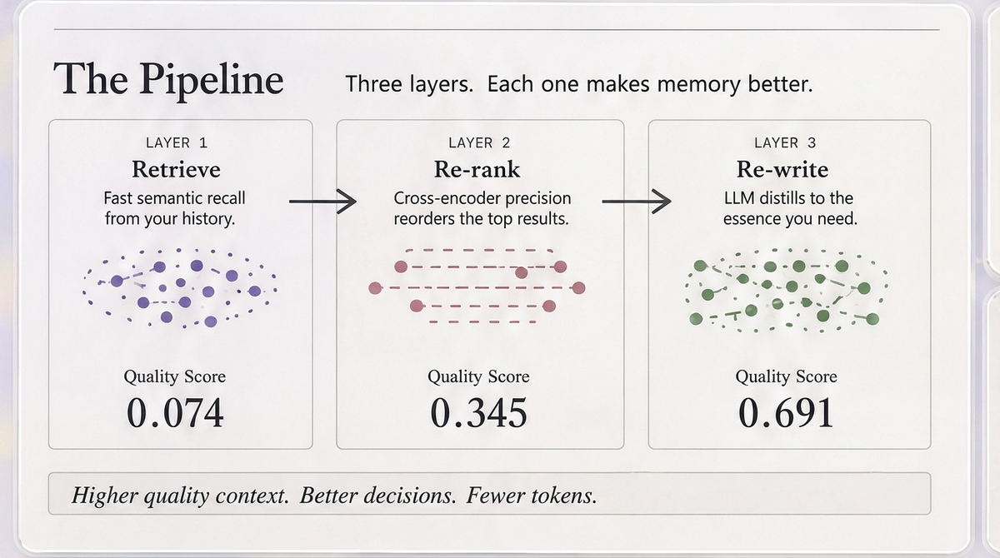
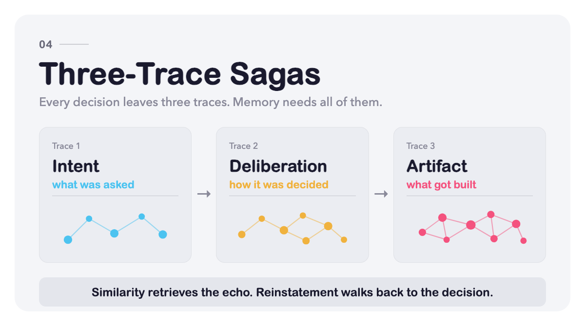

# Claude Self-Reflect

<div align="center">


[](https://www.npmjs.com/package/claude-self-reflect) [](https://www.npmjs.com/package/claude-self-reflect) [](https://opensource.org/licenses/MIT) [](https://github.com/ramakay/claude-self-reflect/releases/latest) [](https://github.com/anthropics/claude-code) [](https://modelcontextprotocol.io/) [](https://github.com/ramakay/claude-self-reflect/tree/main/csr-engine) [](https://github.com/ramakay/claude-self-reflect) [](https://github.com/ramakay/claude-self-reflect/stargazers)

**Claude forgets everything. This fixes that.**

Single 94MB binary. Embedded SQLite, no database server. No containers. No API keys required.

[Install](#install) | [How It Works](#how-it-works) | [MCP Tools](#mcp-tools) | [Paper](docs/plans/annaswamy-2026-similarity-drowns-intent.pdf) | [FAQ](https://ramakay.github.io/claude-self-reflect/#/docs/troubleshooting)

> **v10.1.0: Recap, Dreaming, Multi-Source Memory**
> Each session starts with one recap paragraph (intent, what got done, what was settled, what is open, the next step) instead of a pile of fragments, plus a `learnt` line of what CSR stored last time. Every clause carries a receipt or drops out.
> Dreaming checks old conclusions against your git history and marks a stale anchor with the commit that changed it. No LLM in that check.
> CSR also reads plans, task state, Codex sessions, subagent transcripts, memory-file metadata and the session registry, and ships a companion plugin with a pane beside the session.
> A live code map covers every definition in the repos your sessions work in, across main and every worktree, so CSR can answer for code no conversation touched.
> Local vector search, 5,316 tests passing (4,821 lib, 495 across 23 integration targets, 19 more ignored; verified at commit e7c6e00e), zero external dependencies.
> [Release notes](CHANGELOG.md)



</div>

## Table of Contents

- [The Problem](#the-forgetting-problem) — Why Claude needs memory
- [The Architecture](#one-binary-78mb) — How CSR solves it
- [The Pipeline](#the-pipeline) — Progressive enrichment (9.3x improvement)
- [The Paper](#the-paper) — The research behind the retrieval design (preprint)
- [btw, these too](#btw-these-too): Smaller features that ship with it
- [Install](#install) — One-command install, consent-first activation
- [What You'll Ask](#what-youll-ask) — Natural language, no syntax
- [Performance](#performance) | [MCP Tools](#mcp-tools) | [Hooks](#hooks) | [CLI](#cli-reference)
- [AI Narratives](#ai-narratives-optional) | [Upgrading](#upgrading-from-v7x) | [Troubleshooting](#troubleshooting)

---

## The Forgetting Problem

<a href="https://ramakay.github.io/claude-self-reflect/">
<picture>
  <source media="(prefers-color-scheme: dark)" srcset="docs-site/public/images/card-01-hook-dark.png" />
  
</picture>
</a>

Claude starts fresh every session. Solutions you found, architectures you designed, bugs you debugged — all gone.

Context retention drops below **20% after 10 sessions**. CSR fixes this with a single binary that gives Claude durable, searchable memory of past sessions — not perfect recall, but structured retrieval with evidence-gated forgetting instead of a hard reset every session.

No special syntax. No commands. Install once, and past context appears automatically when you need it.

<br clear="both" />

> **[Explore the full documentation →](https://ramakay.github.io/claude-self-reflect/)**

---

## One Binary. 94MB.

<a href="https://ramakay.github.io/claude-self-reflect/#/docs/architecture">
<picture>
  <source media="(prefers-color-scheme: dark)" srcset="docs-site/public/images/card-02-arch-dark.png" />
  
</picture>
</a>

Everything runs locally in a single process. No Docker, no database server, no API keys required.

- **SQLite** — storage for chunks, embeddings, enrichment state
- **HNSW** — in-memory vector index; `csr-engine eval` times the index lookup on your own data
- **FastEmbed** — 384-dim local embeddings
- **AST** — code-aware search across 6 languages

**7 hooks** fire across the session lifecycle. **16 MCP tools** for explicit search — including `csr_code_graph`, linking code symbols to the conversations that shaped them.

<br clear="both" />

> **[Explore the full documentation →](https://ramakay.github.io/claude-self-reflect/#/docs/architecture)**

---

## The Pipeline

<a href="https://ramakay.github.io/claude-self-reflect/#/docs/enrichment">
<picture>
  <source media="(prefers-color-scheme: dark)" srcset="docs-site/public/images/card-03-pipeline-dark.png" />
  
</picture>
</a>

Three layers progressively improve search quality from raw chunks to AI-enriched narratives — **9.3x improvement**.

Higher quality context. Better decisions. Fewer tokens.

<br clear="both" />

> **[Explore the full documentation →](https://ramakay.github.io/claude-self-reflect/#/docs/enrichment)**

---

## The Paper

<a href="docs/plans/annaswamy-2026-similarity-drowns-intent.pdf">
<picture>
  <source media="(prefers-color-scheme: dark)" srcset="docs-site/public/images/card-04-paper-dark.png" />
  
</picture>
</a>

CSR's retrieval design is documented in a research preprint, measured on the system's own development history:

> **Similarity Drowns Intent: Three-Trace Sagas and Reinstatement Recall for Provenance in Agentic Software Construction**
> 2026 — [PDF](docs/plans/annaswamy-2026-similarity-drowns-intent.pdf)

Ask a memory system "why did we drop Qdrant?" and cosine similarity returns a recording of you asking that question earlier, at 0.984 similarity. The decision itself scores lower than its own echoes. The paper measures this failure, the multi-hop walk built to counter it (+53% and +47% ground-truth session coverage over one-shot kNN on two corpora, pre-registered gates, blind cross-vendor judging), and a second finding that fell out of evaluation: a self-recording memory system ingests its own eval dialogue and drowns the answers it's being tested on. It also keeps its negative results — a pre-registered ratification-weighting hypothesis died at ρ≈0 and forbade an entire staleness design.

<br clear="both" />

---

## btw, these too

Smaller features that ship in this release. Each line says what you get.

### Memory that shows up by itself

- **Recap line:** a session starts with one line on where you left off: intent, what got done, what was settled, what is open, what you corrected, the next step.
- **Learnt line:** one line at session start on what CSR stored for your last session: memory notes, verdicts you confirmed, anchors a commit retired. Each clause carries a receipt. At most 320 bytes.
- **Worktree and subfolder recall:** start Claude in a worktree or a subfolder and you get the repo's history, not an empty memory.
- **Resume lineage:** after `claude -c` or a resume, CSR names the session you continued and treats it as the last session.
- **Dream line at prompt time:** when your prompt names a symbol or file a dream concluded on, one line appears. The same dream never repeats.
- **File history on mention:** name a file in your prompt and its edit history comes along.
- **Trust labels:** model-written context is labelled `[briefing: model-derived, trust=...]`, so Claude knows what is a guess.
- **No self-echo:** CSR text that comes back as input is labeled `[CSR text]`. It stays searchable, ranks below your own words, and is kept out of recaps and briefings. `csr-engine status` counts what it labeled.

### It keeps what Claude Code throws away

- **Transcript mirror:** a scrubbed, zstd-compressed copy of every main and subagent transcript, kept after Claude Code deletes the original. Manage it with `csr-engine mirror sync|status|purge --yes`.
- **Queued prompts:** what you type while Claude is still busy is indexed and searchable like any other prompt.
- **Codex sessions:** if `~/.codex/sessions` exists, your Codex work is searchable next to Claude's. Nothing to set up.
- **Memory file catalogue:** CSR knows which Claude memory files exist (metadata only, never embedded).

### Privacy built in

- **`<private>` tags:** wrap text in `<private>...</private>` and it never reaches memory or the mirror.
- **Secret redaction:** API keys and tokens become `[secret redacted: <kind>]` before they reach the index or the mirror. `CSR_NO_SECRET_SCRUB=1` turns it off.
- **Private companion storage:** the companion's data folder is `0700`, its files `0600`, and tokens and keys are redacted from the text it keeps.
- **Loopback-only journal:** the dream journal binds to 127.0.0.1 only. Its POSTs need a CSRF token, and its pages run no scripts (CSP `default-src 'none'`).

### Commands you can run yourself

- **`csr-engine transcript <session> stats|prompts|tools|files|errors|slice|grep`:** read any session's prompts, tools, files and errors without hand-rolled `jq`.
- **`csr-engine lessons --project P`:** turns corrections you repeated across sessions into candidate CLAUDE.md lines, each with receipts.
- **`csr-engine dreams`:** prints this week's dream per project in the terminal. No browser needed.
- **`csr-engine dream --report`:** writes a self-contained HTML dream journal you can keep or share.
- **`csr-engine ratify <conv-id>`:** scores the sessions you pick right now, without waiting for the queue.
- **`csr-engine bench --format longmemeval|agentmemory`:** reproduces public memory benchmarks.
- **`csr-engine telemetry --tui`:** a live dashboard of hook latency, startup and enrichment health.
- **`csr-engine backfill-stories`:** writes stories for your old sessions.
- **`csr-engine rebuild-index`:** repairs the search index with no daemon running.
- **`csr-engine status --swiftbar`:** macOS menu-bar health, via `scripts/csr-status.30s.sh`.
- **`csr-engine status --deep`:** forces a fresh full integrity check (normally cached).
- **`csr_transcript` (MCP):** the 16th MCP tool, structured reads of any session.

### The dream journal in your browser

Open `http://127.0.0.1:7373/`. `CSR_JOURNAL_PORT` moves the port and `CSR_NO_JOURNAL_SERVER=1` turns the server off.

- **Home:** the week's dreams.
- **`/board`:** open items at a glance. **`/corrections`:** your corrections over time.
- **`/dream/{id}`:** the code's shape before and after, as an AST diff.
- **Act without Claude:** resolve or dismiss a dream in the browser.
- **Scripting:** `/api/dreams` (JSON) and `/healthz`.

### Companion pane, beyond the five axes

The pane needs the [herdr](https://herdr.dev) terminal multiplexer (`brew install herdr`).

- **How Claude read you:** spots shorthand Claude misread, such as "dknr" read as "done".
- **Your rules:** corrections you typed, kept in your own words, never Claude's.
- **CSR told Claude, Last session, Todos left:** cards showing the injected recap, the previous session and carry-over todos.
- **Cockpit gauges:** context, payback, cache and your account quotas.
- **`i` page:** session info, including how many times CSR handed Claude something.
- **Changed since (`l`):** every commit that moved code your past sessions worked on.
- **Shift Map (`m`):** shift, risk, decision and regression rows, each grounded in receipts.
- **Heads up band:** a note when Claude opens a file that has history.
- **You Should Know:** the same idea as Claude Code's own "You should know", fed from your memory.
- **Terms coach:** offers a `## Terms` line for your CLAUDE.md that teaches Claude your shorthand.
- **Push guard:** opt-in. Blocks `--no-verify` and pushes to protected branches. A guard rail, not a security boundary.
- **"Later" survives compaction:** threads you deferred are carried across compaction, and subagents keep their task brief through their own compaction.
- **autoCompact:** `off`, `suggest` (default) or `auto`.
- **`/csr statusline`:** moves your status bar into the pane, and restores it when the pane closes.
- **Phone layout:** the pane has a layout for a narrow terminal.
- **One dreamer per session, crash guard:** a lease stops two dreamers on one session, and a broken edit to the pane does not kill it.

### Quiet MCP niceties

- **Argument completions:** project, file, session, time range and concept complete as you type.
- **Background tasks:** heavy tools run as MCP Tasks, so long calls never block.
- **Upgrade notice:** after an upgrade, results tell you to restart a session that still runs the previous build.
- **Keyword fallback:** results come back as `[keyword]` matches when the vector path is down.
- **Health resource:** `status://system-health`, readable from inside Claude.
- **Confirmations:** you confirm before a reflection over 2,000 characters is stored, and `csr_resolve` verdicts are confirmed against a SHA-256 of the payload.

### It looks after itself

- **Hands-free upgrades:** the daemon exits when its binary is replaced, so launchd restarts it on the new build.
- **Recall canary:** a known-item recall check runs on a six-hour loop.
- **Catch-up sweep:** every 30 minutes, so no transcript is missed.
- **Installer checks:** it warns when an older `csr-engine` earlier on your PATH would win, and restarts the daemon so an upgrade takes effect.

### Dials

- **Kill switches:** `CSR_NO_RECAP`, `CSR_NO_LEARNT`, `CSR_NO_DREAMING`, `CSR_NO_DREAM_INJECT`, `CSR_NO_DREAM_ON_COMPACT`, `CSR_NO_MIRROR`, `CSR_NO_SECRET_SCRUB`, `CSR_NO_STORY_MAP`, `CSR_NO_CODEX_IMPORT`, `CSR_NO_HEALTH`, `CSR_NO_JOURNAL_SERVER`, `CSR_NO_AI_NARRATIVES`. In herdr the pane also follows herdr's event socket; `CSR_PANE_HERDR_EVENTS=0` switches that off.
- **Dream cost:** `CSR_DREAM_EFFORT=less|balanced|max` and `CSR_DREAM_BUDGET`.
- **Dream timing:** `CSR_DREAM_INTERVAL_SECS`, `CSR_DREAM_IDLE_MINS` (default 30), `CSR_DREAM_FLOOR_HOUR` (default 3).
- **Search path:** `CSR_SEARCH_MODE=hybrid|vector|fts`.
- **CPU caps:** `CSR_EMBED_THREADS`, `CSR_TOKIO_WORKERS`.

---

## Install

```bash
curl -fsSL https://raw.githubusercontent.com/ramakay/claude-self-reflect/main/scripts/install.sh | sh
```

Downloads the binary (SHA256-verified), then asks before activating. Setup registers the MCP server, installs 7 hooks, imports your conversations, installs the companion plugin and, on macOS, installs and starts the background daemon (a launchd agent that runs dreams and enrichment; `CSR_NO_DAEMON=1` skips it). It only runs with your consent. Restart Claude Code after.

Non-interactive installs never activate on their own: set `CSR_AUTO_SETUP=1` to opt in, or run `csr-engine setup` yourself.

| Platform | Support |
|----------|---------|
| macOS (Apple Silicon) | Prebuilt binary |
| Linux x86_64 / WSL | Prebuilt binary |
| Linux ARM64 | Prebuilt binary |
| macOS (Intel) | Build from source |

<details>
<summary>Alternative: npm</summary>

```bash
npm install -g claude-self-reflect
claude-self-reflect setup   # activation is a separate, explicit step
```

By default `npm install` only downloads the checksummed binary — it does not touch `~/.claude` or index conversations. Activation happens when you run `claude-self-reflect setup`, or set `CSR_AUTO_SETUP=1` during install to opt in. That command runs the binary npm downloaded, so it works before `~/.local/bin` is on your PATH.

</details>

<details>
<summary>Build from source</summary>

```bash
git clone https://github.com/ramakay/claude-self-reflect.git
cd claude-self-reflect/csr-engine
cargo build --release
cp target/release/csr-engine ~/.local/bin/
csr-engine setup
```

</details>

### The companion pane (optional)

A Claude Code plugin that sits beside the session. The pane needs the [herdr](https://herdr.dev) terminal multiplexer (`brew install herdr`). It shows what your memory handed Claude, the agents and Codex runs in flight, the dreamer's "what if...?", and a compaction coach. It needs Claude Code 2.1.296 or later. It runs inside `csr-engine` itself: the plugin is one generated file that starts `csr-engine companion serve`, so it needs no Node, TypeScript or Python. `csr-engine setup` writes that plugin and installs it through Claude Code's own plugin CLI, after the same consent. `csr-engine setup --no-companion` skips it. If setup cannot install it, it prints why, and you can retry with one command:

```bash
csr-engine companion plugin install
```

<details>
<summary><strong>What You'll Ask</strong> — after install, just ask Claude naturally</summary>

- *"How did we solve re-renders on this component?"*
- *"What did we tell Joe about that commit?"*
- *"What were our frustrations with this approach?"*
- *"Where did we put the auth middleware config?"*

No special syntax. No commands. CSR finds relevant past context and injects it automatically.

</details>

<details>
<summary><strong>Performance</strong> — what the built-in eval measures</summary>

| Metric | Value |
|--------|-------|
| **Cached startup** | Loads the saved index; the time grows with index size |
| **Vector index lookup (p95)** | Timed by `csr-engine eval` on your own index (target under 1 ms). It covers the lookup only, not a full recall call. |
| **Binary size** | 94MB (aarch64-apple-darwin release build) |
| **Embedding** | Local MiniLM model, 384 dimensions, no API call |

</details>

<details>
<summary><strong>MCP Tools</strong> — 16 annotated tools available to Claude</summary>

All tools include [MCP tool annotations](https://spec.modelcontextprotocol.io/specification/2025-11-05/server/tools/#annotations) so Claude Code understands their safety characteristics.

| Tool | Description | Safety |
|------|-------------|--------|
| `csr_reflect_on_past` | Semantic search across past conversations | read-only |
| `store_reflection` | Store insights for future retrieval | **writes** |
| `csr_quick_check` | Fast existence check (count + top match) | read-only |
| `search_by_recency` | Time-constrained search ("last week") | read-only |
| `get_recent_work` | "What did we work on?" with session grouping | read-only |
| `get_timeline` | Activity timeline with statistics | read-only |
| `csr_search_by_file` | Find conversations that touched a file | read-only |
| `csr_search_by_concept` | Theme-based search ("security", "testing") | read-only |
| `csr_search_insights` | Aggregated patterns from search results | read-only |
| `csr_get_more` | Paginate through additional results | read-only |
| `get_full_conversation` | Retrieve complete JSONL conversation | read-only |
| `get_session_learnings` | Iteration-level memory for Ralph loops | read-only |
| `csr_code_graph` | Which conversations shaped a function or file (AST anchors) | read-only |
| `csr_why` | Provenance chain — why does this code/decision exist | read-only |
| `csr_resolve` | Record verified verdicts (resolved/still_open/regressed) on chunks | **writes** |
| `csr_transcript` | Structured facts from one session transcript: stats, prompts, tools, files, errors, slices, grep | read-only |

</details>

<details>
<summary><strong>Hooks</strong> — 7 session lifecycle hooks</summary>

| Hook | What it does |
|------|-------------|
| **SessionStart** | Surfaces relevant past context at conversation start |
| **UserPromptSubmit** | Predicts and injects context before Claude responds |
| **PostToolUse** | Tracks file edits with session-scoped dedup |
| **Stop** | Imports the transcript, keeps a rolling summary, stores a structured episode |
| **PreCompact** | Imports the transcript, refreshes the recap anchor, starts one dream cycle |
| **PostCompact** | Stores Claude Code's own compaction summary once, as derived context |
| **SessionEnd** | Stores session narrative for future retrieval |

All hooks use catch-all error handling. They never block Claude Code.

</details>

<details>
<summary><strong>Experimental: Claude Mods</strong> — CSR recall as an in-process function hook</summary>

Claude Code is adding "Claude Mods" (function hooks, anthropics/claude-code#91870):
plugin TypeScript that runs in-process with a typed `$` instead of a shell command per
event. `mods/csr-recall/` is a spike of CSR recall on that surface: one `prompt.submit`
hook calls the `claude-self-reflect` MCP server through `$.mcp.call` and attaches the top
hits as a context block. Nothing installs it; load it explicitly:

```bash
CLAUDE_CODE_ENABLE_FUNCTION_HOOKS=1 claude --plugin-dir /abs/path/claude-self-reflect/mods/csr-recall
```

Observed on Claude Code 2.1.270: MCP answered in 95 ms, block attached in 99 ms, hook
settled in 997 ms. The shell hooks keep running underneath. Receipts and caveats in
`mods/csr-recall/README.md`.

</details>

<details>
<summary><strong>AI Narratives</strong> — optional 9.3x quality boost</summary>

Transform raw conversations into rich, searchable narratives. The briefing and story calls run through `claude -p`, which signs in the way Claude Code does on your machine, so CSR needs no API key of its own. An `ANTHROPIC_API_KEY` is read directly only by the optional Batch API path (the daemon or the MCP server), and a `claude -p` call inherits a key that is in its environment.

```bash
csr-engine daemon
```

| Metric | Without | With AI Narratives |
|--------|---------|-------------------|
| Search quality | 0.074 | 0.691 (9.3x) |
| Token compression | 100% | 18% (82% reduction) |
| Cost per conversation | - | ~$0.012 (Batch API path, needs a key) |

> **Token transparency:** Optional AI narratives (session briefings + story extraction) run
> `claude -p` against your existing Claude subscription — smallest available model, capped
> prompts, debounced, and skipped entirely when nothing changed. Every call — including failures and timeouts — is counted:
> `csr-engine status` shows calls and tokens spent today; cache read/creation tokens (often
> the majority of real usage) are tracked separately in the status JSON (`cache_tokens_today` /
> `cache_tokens_total`). Disable anytime with
> `CSR_NO_AI_NARRATIVES=1` (this does not stop the Batch API path); pin a model with `CSR_NARRATIVE_MODEL=<model>`.

</details>

<details>
<summary><strong>CLI Reference</strong></summary>

```
csr-engine                     Start MCP server (default)
csr-engine setup               One-shot setup: import + MCP + hooks
csr-engine status              System status (JSON)
csr-engine status --compact    One-line statusline output
csr-engine daemon              Background enrichment daemon
csr-engine hook install --apply Install Claude Code hooks
csr-engine eval                Quick eval (6 checks)
csr-engine eval --full         Full eval (24 results plus a census line; 44s on a 10GB database, most of it the integrity check)
csr-engine quality <file>      AST-based code quality analysis
```

</details>

<details>
<summary><strong>Upgrading from v7.x</strong></summary>

v8.0 replaces the Python/Docker stack with a single Rust binary.

```bash
docker compose down 2>/dev/null
curl -fsSL https://raw.githubusercontent.com/ramakay/claude-self-reflect/main/scripts/install.sh | sh
```

Your conversation data (`~/.claude/projects/`) is untouched. The new engine re-imports from the same JSONL files.

</details>

<details>
<summary><strong>Troubleshooting</strong></summary>

| Symptom | Fix |
|---------|-----|
| No search results | Run `csr-engine setup` |
| MCP tools not available | Run `csr-engine setup`, restart Claude Code |
| "spawn ENOENT" in MCP | Ensure `csr-engine` is in PATH |
| Slow first startup | Normal (the index is rebuilt once; later starts load the saved index, which takes longer for a larger index) |

Full guide: [Documentation](https://ramakay.github.io/claude-self-reflect/#/docs/troubleshooting)

</details>

<details>
<summary><strong>Uninstall</strong></summary>

There is no `uninstall` command. `npm uninstall` does not touch your Claude Code settings, and `csr-engine hook install --apply` only adds hooks. Remove the hooks and the daemon by hand:

```bash
# 1. Stop the daemon LaunchAgent that setup installed (macOS)
launchctl bootout gui/$(id -u)/com.ramakay.csr-engine.daemon
rm ~/Library/LaunchAgents/com.ramakay.csr-engine.daemon.plist

# 2. Unregister the MCP server
claude mcp remove claude-self-reflect

# 3. Delete CSR's data, including the transcript mirror
rm -rf ~/.claude-self-reflect/

# 4. Delete the binary
rm ~/.local/bin/csr-engine
npm uninstall -g claude-self-reflect  # if installed via npm
```

Then open `~/.claude/settings.json` and delete every entry under `hooks` whose command starts with `csr-engine hook` (SessionStart, UserPromptSubmit, PostToolUse, Stop, PreCompact, PostCompact, SessionEnd). Claude Code keeps calling them until you do, and they fail once the binary is gone. If you installed the companion plugin, remove it with `/plugin` in Claude Code.

</details>

<details>
<summary><strong>Contributors (v1–v7)</strong></summary>

- **[@TheGordon](https://github.com/TheGordon)** - Fixed timestamp parsing (#10)
- **[@akamalov](https://github.com/akamalov)** - Ubuntu WSL insights
- **[@kylesnowschwartz](https://github.com/kylesnowschwartz)** - Security review (#6)

</details>

---

[Documentation](https://ramakay.github.io/claude-self-reflect/) | [npm](https://www.npmjs.com/package/claude-self-reflect) | [Issues](https://github.com/ramakay/claude-self-reflect/issues) | MIT License
